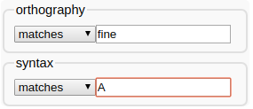

---
format:
  html:
    toc: true
  pdf: 
    toc: false
    fontfamily: linguisticspro
---
# 7a. CELEX

LaBB-CAT can be integrated with the CELEX lexicon, which can be
purchased from the Linguistic Data Consortium (LDC) and includes lemma,
part of speech, morphological, phonological, and frequency information
for English, German, and Dutch.

(If you don't have CELEX, there is an 
[alternative version of this exercise](7b-lexicon-cmudict.qmd)
that uses the free 'CMU Pronunouncing Dictionary' lexicon,
which you can work through instead.)

In this exercise you will:

-   Install the CELEX layer manager
-   Use it to create new annotations for word morphology, syntactic
    category, and phonology
-   Compute speech rate in syllables per minute
-   Incorporate the new layers in more sophisticated searches

## Installation

The first thing we're going to do is install the CELEX layer manager.

This requires having the LDC's CELEX data files on your computer, which
will be processed by the layer manager in order to insert the data into
the LaBB-CAT database. If you received the CELEX files in a ZIP file,
you need to unzip that into a folder, and remember the location of that
folder, as you'll need it during the installation process.

(@) First of all, create a new project called *CELEX* with a
    description: *CELEX Annotations*
(@) Click the *layer managers* menu option.
(@) Click the *List of layer managers that are not yet installed* link
    near the bottom.
(@) Find "CELEX English" in the list, and click its *Install* button.
(@) You will see a *Choose file* or *Browse* button. Press it, and select
    the *ENGLISH.zip* file that contains the CELEX lexicon files.\
    There will be a progress bar while the file is uploaded. Once the upload
    is finished, the progress bar will disappear.
(@) Press *Configure*.\
    You will see a progress bar while the layer manager loads the data
    from the CELEX files into the LaBB-CAT database. This will take a
    few minutes.
(@) Once it's finished, you will see a new window open with information
    about the CELEX English layer manager.
    
## Morphology

Now that we've installed the layer manager, we'll create our first
annotations from CELEX - a layer with morphological annotations.

(@) On the *word layers* page, create a layer for word morphology - i.e.:
    -   **Layer ID:** `morphology`
    -   **Type:** *Text*
    -   **Alignment:** *None*
    -   **Manager:** *CELEX English*
    -   **Project:** *CELEX*
    -   **Description** `Morphological parses`
    -   \...configured with the *Morphology* option selected, and the
        default values for everything else.

:::{.callout-tip}
ⓘ If you're curious about what the configuration
options do, and how you can test out the results of your
configuration, check the online help, which is a section at the top of the configuration
page that opens when you click the `ⓘ` icon.
:::

(@) Once the layer has finished generating, select the *transcripts* menu
    option, and open the first transcript in the list.
(@) On the *Layers* tab, tick the *CELEX* project, and then tick your new *morphology*
    layer.\
    You will see that each word is tagged with morphological
    information.

If you were to do a search for words ending in "ing" on the
orthography layer, you would get both gerunds like "coming" and also
words like "thing" and "anything" whose "ing" is part of the base
word, not a morphological affix. You can now tell these apart in
searches, by searching the *morphology* layer for words that end in
"+ing".

(@) Do a search on the *orthography* layer of words ending in "ing".
    Leave the results tab open, so you can compare these results with
    the next search ...
(@) Now do a search on the *morphology* layer of words ending in
    "+ing", and compare the results.

:::{.callout-important}    
Remember that in regular expressions the 'plus' character `+`
has a special meaning - it means "one or more of the previous
thing". 

In order to search for a literal "+" in the annotation,
you have to 'escape' the `+`. Consult the *Regular Expression* section of the help
page to figure out how to do that.
:::

## Syntactic Categories
    
Now we will create a layer for syntactic categories from CELEX.

(@) Create a new layer for annotating words with their syntactic
    categories from CELEX:
    -   **Layer ID:** `syntacticCategory`
    -   **Type:** *Text*
    -   **Alignment:** *None*
    -   **Manager:** *CELEX English*
    -   **Project:** *CELEX*
    -   **Description:** `All possible syntactic categories`
    -   \...configured with the *Syntax* option ticked, and the default
        values for everything else.
(@) Before pressing the *Set Parameters* button on the configuration page, 
    change the *Test word* at the bottom to `fine` and check the resulting 
    *Test Results*\
    These are all the possible syntactic categories for the word "fine"
    ordered most-frequent first. 
(@) Press *Set Parameters* and the *Regenerate*.
(@) Once the layer has finished generating, go to the search page and do
    a search for the word "fine" on the *orthography* layer.
(@) Open the transcript of the first match.
(@) On the *Layers* tab, tick the syntactic category layer to display the annotations that
    have just been computed.
(@) Now find your instance of the word "fine" again (it's highlighted
    in the transcript text).\
    You will see that it has "A" for adjective above it.
(@) Hover your mouse over the syntactic category label "A".\
    You will see that a number of other labels appear: "V", "N", "ADV".\
    These are all the possible syntactic categories for the word "fine"
    ordered most-frequent first. Only the first one is displayed in the
    transcript, but when you do searches, all of them are searched.
(@) On the search page, do a search for *fine* on the *orthography*
    layer and *A* on the syntactic category layer in the same column.\
    This has the effect of 'ANDing' together the patterns for a single
    word, so it will give you words that have "fine" on the
    *orthography* layer have *A* on the *syntacticCategory*\* layer.\
    
(@) Do another search, for *fine* on the *orthography* layer and *V* on
    the *syntacticCategory* layer.\
    Notice that the results are the same. This is because all of the
    instances of "fine" are marked as 'possibly an adjective' and also
    'possibly a verb'.
    
As you can see, simply tagging tokens with all possible syntactic
categories from the CELEX lexicon leads to search results that are
heavy on false positives. In order to tag tokens with a single
syntactic category, we would need to perform 'disambiguation' by
taking the surrounding transcript into account, in order to decide
which of all the possibilities is the correct syntactic category.
LaBB-CAT has two layer managers that perform such part-of-speech
tagging: the "StanfordPosTagger" and the "MorTagger". Neither of
these use the exact same syntactic labels that are used by CELEX.

## Syllable Count and Speech Rate
    
CELEX can be used to retrieve syllable-counts for words, which in
turn can be used, with duration information, to compute speech rate.
For each line in each transcript, we already have the start time and
the end time, from which we can calculate the duration of the line.
All we need now is the number of syllables per line, and we can
compute the syllables-per-minute speech rate for each line.

(@) Create a new word layer:
    -   **Layer ID:** `syllableCount`
    -   **Type:** *Number*
    -   **Alignment:** *None*
    -   **Manager:** *CELEX English*
    -   **Project:** *CELEX*
    -   **Description:** `Number of syllables`
    -   \...configured with the *Syllable count* option ticked\

:::{.callout-important}        
Ensure the *First match only* option is ticked for this layer.

 If you're not sure why, this is explained in the
online help for the layer configuration page.
:::

(@) Once the layer has finished generating, have a look at a transcript
    or two to check the results.
(@) Click the *phrase layers* menu option.
(@) Add a new phrase layer for speech rate. Key points are:
    -   The layer manager to use is the *Statistics Layer Manager.*
    -   The layer to summarize should be the *syllableCount* layer.
    -   The statistic to compute is *Label-Sum Rate (per minute)*
    
        ::: {.callout-tip}    
         If in doubt, the online help may help.
        :::
        
    -   You can calculate over whatever scopes you like, but if you
        select *Utterances* this will give you a local speech rate which
        might be useful when looking at individual search results, and
        *Participants* might be interesting if you want to compare
        speech rate between speakers.
(@) Have a look in a transcript or two, and a participant or two, to see
    what the annotations you just generated look like.
    
## Phonology

Now we're going to create a phonemic-transcription layer.

(@) Create a new word layer, called *phonemes*, similar to previous CELEX layers. Key points are:
    -   The layer type should be set to *Phonological*.
    -   The *Phonology* option should be selected in the layer
        configuration.

The original ELAN transcripts contain 'pronounce' annotations for some interrupted words 
and disfluencies (these are marked in ELAN with square brackets). 
These are tokens that will not be in the CELEX lexicon, but which can nevertheless 
be tagged with a pronunciation, by copying the 'pronounce' annotations into the 
*phonemes* layer.

To do this automatically:

(@) On the *word layers* page, find the *phonemes* layer, and press the 
    *Pronounce Auxiliary* icon - it has a large plus-sign ➕ on it.\
    This will display a confirmation message.
(@) Press *yes*\
    A progress bar will be displayed while the 'pronounce' annotations are copied.
(@) Once the layer is finished generating, open the `AP513_Steve.eaf` transcript.
(@) On the *Layers* tab, tick the *CELEX* project, and the *phonemes* and *pronounce* layers.
    
You will notice that the annotations are displayed using IPA
symbols. However, CELEX doesn't use IPA symbols directly, it
actually uses the 'DISC' encoding for phonemes, which uses ordinary
'typewriter' characters (ASCII), and uses exactly one character per
phoneme. The IPA symbols are being displayed by LaBB-CAT to provide
a linguist-friendly interpretation of the phonemic transcription.
But you can disable this to see the underlying DISC characters by de-selecting the
'interpretation' option on the layer in the transcript.

(@) On the *Layers* tab, immediately to the right of the *phonemes* layer, 
    there is a tags icon . \
    Hover the mouse over it to check the description, and then click it.

You may find that this is somewhat harder to read. Diphthongs are
generally represented by digits, schwa is `@`, and various other
characters are used to represent affricates, etc.

It's nice to display the IPA symbols, but it's important to understand
the DISC symbols (shown in table below, because they are what we have to
use when searching on the *phonemes* layer, which we are going to try
now.



  ----- ------ -------------- --- ----- ------ --------------
  IPA   DISC                      IPA   DISC    
  p     `p`    **p**at            ɪ     `I`    K**I**T
  b     `b`    **b**ad            ε     `E`    DR**E**SS
  t     `t`    **t**ack           æ     `{`    TR**A**P
  d     `d`    **d**ad            ʌ     `V`    STR**U**T
  k     `k`    **c**ad            ɒ     `Q`    L**O**T
  g     `g`    **g**ame           ʊ     `U`    F**OO**T
  ŋ     `N`    ba**ng**           ə     `@`    **a**nother
  m     `m`    **m**at            i:    `i`    FL**EE**CE
  n     `n`    **n**at            α:    `#`    ST**A**RT
  l     `l`    **l**ad            ɔ:    `$`    TH**OU**GHT
  r     `r`    **r**at            u:    `u`    G**OO**SE
  f     `f`    **f**at            ɜ:    `3`    N**UR**SE
  v     `v`    **v**at            eɪ    `1`    F**A**CE
  θ     `T`    **th**in           αɪ    `2`    PR**I**CE
  ð     `D`    **th**en           ɔɪ    `4`    CH**OI**CE
  s     `s`    **s**ap            əʊ    `5`    G**OA**T
  z     `z`    **z**ap            αʊ    `6`    M**OU**TH
  ∫     `S`    **sh**eep          ɪə    `7`    N**EAR**
  ʒ     `Z`    mea**s**ure        εə    `8`    SQU**ARE**
  j     `j`    **y**ank           ʊə    `9`    C**URE**
  x     `x`    lo**ch**           æ     `c`    t**i**mbre
  h     `h`    **h**ad            ɑ̃ː    `q`    dét**en**te
  w     `w`    **w**et            æ̃ː    `0`    l**in**gerie
  ʧ     `J`    **ch**eap          ɒ̃ː    `~`    bouill**on**
  ʤ     `_`    **j**eep                         
  ŋ̩     `C`    bac**on**                        
  m̩     `F`    idealis**m**                     
  n̩     `H`    burd**en**                       
  l̩     `P`    dang**le**                       
  ----- ------ -------------- --- ----- ------ --------------

(@) Go to the *search* page.
(@) Create a search matrix that's two words wide, and includes
    the *orthography* and *phonemes* layers.
    
Now we're going to do a search for the word "the" followed by a word that starts with schwa.
    
(@) Type `the` in the first *orthography* box.
(@) Click the second box on the *phonemes* layer, but don't enter anything in the box yet.
(@) The box has a little {height="12pt"} button to the right of it.\
    Hover the mouse over it to see what it says, and then click it.\
    You will see that a section opens with a bunch of phoneme symbols
    on it.
(@) Find the schwa symbol *ə* and click it.\
    You will see that a `@` symbol appears in the box.\
    `@` is the DISC symbol for *ə*, so in order to search for schwa, we
    have to use it in our search pattern.
(@) We want words that start with schwa, so type `.*` after the `@` symbol.
(@) Press *Search*.

You will see that some of the words being matched are words that you
might not normally think start with a schwa. LaBB-CAT is matching
words against *all their possible phonemic transcriptions*, so if
CELEX has multiple possible pronunciations for a word, and one of
them starts with schwa, it will be matched.

You can check this by clicking on a match, and then hovering your mouse
over the phonemic transcription above the matching token.
This displays all the annotations for the given token, i.e. in this case 
all the possible pronunciations of that word.

Now that we have phonemic transcripts, we can do a better job of the
search we tried in an earlier exercise -- "the" followed by a
word starting with a vowel...

(@) Change your search so that, instead of just `@` at the beginning of
    the word, it matches any vowel.

You could use the square-brackets `[]` at the start of your pattern,
and type all vowel symbols inside them - Note that the vowels in the
DISC representation extend beyond a, e, i, o, and u - you should add
in all the vowels you see in the list that appears when you expand
the IPA helper, including all the diphthongs.

*Alternatively*, you can simply click the *VOWEL* link in the
'Phoneme Symbol Selector', which will add all the DISC vowels for
you, already enclosed in square-brackets.

(@) Run the search and check that it's giving you what you expect.
    Notice that now there are no 'false positives' like "the one" that
    we were getting when searching by orthography alone.

Now that you've generated a few different layers, and have seen how the
search matrix works, you might want to try out some of the following
searches, or invent some others:

-   Instances of an article followed by a noun
-   Words which have the DRESS vowel as the second phoneme
-   The word "the" followed by a word beginning with the phoneme /k/
-   Words ending with schwa, followed by words beginning with /p/ or /b/
-   Words that begin with "k" in their spelling, but begin with the
    phoneme /n/
-   Words that begin with "k" in their spelling, but *do not* begin
    with the phoneme /n/
-   Plurals that end in /s/ or /z/ or /ɪz/
